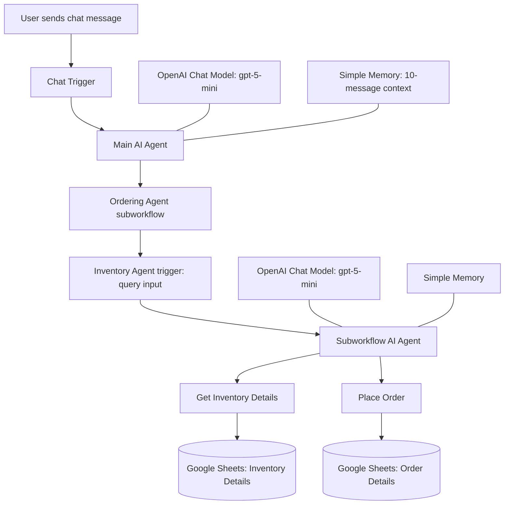

Jarvis Cafe Bot
An AI-powered cafe assistant built with n8n, OpenAI
(gpt-5-mini), and Google Sheets. The project combines a
chat-facing main workflow with an Ordering Agent subworkflow to handle
inventory questions and order placement.
Project overview
Jarvis Cafe Bot consists of two connected n8n workflows:
1. Jarvis Cafe Bot (main workflow) --- receives messages from the
   chat interface, uses an AI Agent to interpret the request, and calls
   the Ordering Agent subworkflow.
2. Ordering Agent (subworkflow) --- receives the request, looks up
   inventory information or appends an order to Google Sheets.
Both workflow JSON files are required for the complete functionality.
The main workflow references the subworkflow; it does not contain the
subworkflow's internal nodes.
Features
- Responds to messages through the n8n chat trigger.
- Uses OpenAI gpt-5-mini in both workflows.
- Maintains short conversational context in the main workflow
  (10-message context window).
- Retrieves item and price information from the Inventory Details
  worksheet.
- Is instructed to show item names and prices without exposing stock
  values.
- Collects missing order details: customer name, item, quantity,
  contact number, and delivery method.
- Supports Pick Up and Door Delivery.
- Generates an order ID and appends order details to the
  Order Details worksheet.
- Is instructed to add ₹40 for door delivery.
Important billing note: The subworkflow's current Google Sheets
append mapping includes Name, OrderItem, Quantity,
Contact Number, Order Id, and Delivery Method. It does not
explicitly map a total-bill field. The prompt mentions adding ₹40 for
door delivery, but the exported mapping alone does not confirm that a
calculated total is stored. Verify the calculation and sheet schema
before using this workflow for live orders.

Architecture

Workflow details
1. Main workflow --- Jarvis Cafe Bot
The main workflow is the user-facing entry point.
  Node                                Purpose
  When chat message received        Receives messages from the n8n chat
                                      interface.

  AI Agent                          Interprets the user's request and
                                      coordinates the task.

  OpenAI Chat Model                 Provides the gpt-5-mini language
                                      model.

  Simple Memory                     Keeps a 10-message context window.

  Ordering Agent                    Calls the subworkflow and passes a
                                  query input.
The main agent's system message describes the Ordering Agent as the
subworkflow for retrieving inventory details and placing orders.
2. Subworkflow --- Ordering Agent
The subworkflow starts with an Execute Workflow Trigger named
Inventory Agent. It accepts a query string from the main workflow
and uses its own AI Agent and Google Sheets tools.
  Node                                Purpose
  Inventory Agent                   Receives the query input from the
                                      parent workflow.

  AI Agent                          Interprets the query and chooses
                                      the relevant tool.

  OpenAI Chat Model                 Provides the gpt-5-mini language
                                      model.

  Simple Memory                     Uses the incoming query as its
                                      custom session key.

  Get Inventory Details             Reads data from the
                                      Inventory Details worksheet.

  Place Order                       Appends the configured order fields
                                  to the Order Details worksheet.
Inventory requests
The agent is instructed to read from the Inventory Details worksheet
in the Jarvis Cafe Master spreadsheet and show only item names and
prices---not stock values.

Example: - "Show me the cafe menu and prices." - "What is the price of
\(item\)?"
Order requests
When placing an order, the agent is instructed to request any missing
details:
- Customer name
- Order item
- Quantity
- Contact number
- Delivery method (Pick Up or Door Delivery)
The agent is instructed not to ask for a payment method. It should
generate a unique order ID and append the order to the Order Details
worksheet.

Example: - "I'd like to order two coffees." - "Place an order for
\(item\), quantity \(number\), for pickup." - "I need door delivery for
\(item\)."

The agent may ask follow-up questions when required details are missing.
Google Sheets setup
The workflows reference a spreadsheet named Jarvis Cafe Master
with these worksheets:
- Inventory Details --- inventory information used to answer
  item and price questions.
- Order Details --- destination for newly placed orders.
The current Place Order node maps these fields:
- Name
- OrderItem
- Quantity
- Contact Number
- Order Id
- Delivery Method
Make sure the worksheet headers match the configured mappings. If you
want to store the order total, add an appropriate column and configure
the workflow to calculate and write that value. Confirm that the ₹40
door-delivery fee is correctly applied in the actual order calculation.
Requirements
- An n8n instance with the required Chat Trigger, AI Agent, Simple
  Memory, OpenAI Chat Model, Execute Workflow Trigger, and Google
  Sheets nodes.
- An OpenAI connection configured for gpt-5-mini (or a supported
  model you choose).
- Google Sheets OAuth credentials with permission to read and append
  rows.
- Access to the Jarvis Cafe Master spreadsheet and both worksheets.
- Both workflow JSON exports:
  - Jarvis Cafe Bot.json
  - Ordering Agent.json
Installation and configuration
1. Import the subworkflow first. Import Ordering Agent.json into
   n8n.
2. Configure credentials. Set up the OpenAI model connection and
   Google Sheets OAuth credentials in the subworkflow.
3. Verify the spreadsheet. Confirm that the selected spreadsheet
   and worksheets are correct and that the required columns exist.
4. Import the main workflow. Import Jarvis Cafe Bot.json.
5. Reconnect the subworkflow reference. Open the main workflow's
   Ordering Agent tool node and select the imported Ordering Agent
   workflow if the existing reference does not resolve. Workflow IDs
   may differ between n8n instances.
6. Configure the main agent. Confirm its OpenAI connection and chat
   trigger settings.
7. Test inventory lookup. Ask for the menu or the price of an item
   and verify that stock values are not shown.
8. Test order placement. Provide an order with missing information
   and check that the agent asks for the required details.
9. Test both delivery methods. Test Pick Up and Door Delivery;
   inspect the resulting spreadsheet row and verify the fee and total
   calculation.
10. Enable for real use only after validation. Use sample data
    during testing and verify the full flow before accepting live
    orders.
Repository structure
Keep the two workflow exports and this README in the same GitHub
repository:
Jarvis-Cafe-Bot/
├── README.md
├── Jarvis Cafe Bot.json
└── Ordering Agent.json
Name this combined documentation file README.md so GitHub displays it
on the repository home page.
Import and export notes
- The main workflow and subworkflow are separate n8n workflows. Export
  each one as its own JSON file.
- Import Ordering Agent.json before importing or configuring the
  main workflow.
- After importing, verify the main workflow's subworkflow reference
  and reselect it if necessary.
- Workflow JSON exports do not provide working credentials.
  Reconfigure credentials in the destination n8n instance.
- The workflows reference a Google spreadsheet named
  Jarvis Cafe Master; confirm that the destination Google account
  has access to the intended spreadsheet.
Security and privacy
- Customer names and contact numbers may be written to Google Sheets.
  Limit spreadsheet and workflow access to authorized users.
- Do not commit API keys, OAuth tokens, passwords, or other secrets to
  GitHub.
- Review exported JSON files before publishing. They may contain
  spreadsheet IDs, workflow IDs, webhook metadata, or other
  environment-specific information. Replace or remove details you do
  not want to make public.
- Use test data while validating the workflows.
Troubleshooting
  Problem                             What to check
  Main agent cannot call the          Open the Ordering Agent tool node
  subworkflow                         and select the imported subworkflow
                                      again.

  OpenAI model fails                  Verify the model selection and
                                      configure valid OpenAI credentials
                                      or AI Gateway access.

  Inventory lookup fails or returns   Check Google Sheets credentials,
  unexpected results                  spreadsheet access, worksheet
                                      selection, and inventory
                                      data/headers.

  Order is not appended               Confirm write permissions and that
                                      the Order Details headers match
                                      the configured field mappings;
                                      inspect the n8n execution details.

  Required order details are missing  Test the conversation and confirm
                                      the agent asks for name, item,
                                      quantity, contact number, and
                                      delivery method.

  Delivery fee or total is incorrect  Verify the actual calculation and
                                      add/map a total-bill field if the
                                      total needs to be saved. The
                                      current exported mapping does not
                                  include a total field.
License
Add a LICENSE file and specify the terms under which you want to
distribute this project before publishing it for reuse.
