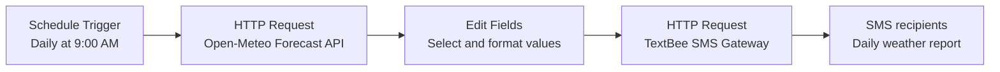

Daily Weather Report Automation 🌦️

An n8n workflow that automatically sends a daily weather report for Visakhapatnam, India, by SMS. It retrieves current weather data from the Open-Meteo API, formats the key measurements, and sends the report through the TextBee SMS gateway.

✨ Features
- Scheduled execution: Configured to run daily at 9:00 AM
  according to the n8n instance's configured timezone.
- Live weather data: Fetches current conditions from
  Open-Meteo.
- Readable SMS report: Formats temperature, feels-like
  temperature, relative humidity, and wind speed.
- SMS delivery: Sends the report to configured recipients through
  the TextBee gateway.
- Low-code automation: Connects the steps visually in n8n without
  requiring a custom application.

🔄 Workflow

Node breakdown
1. Schedule Trigger --- starts the workflow on a daily schedule at
   9:00 AM. The actual timezone is determined by your n8n
   configuration.
2. HTTP Request --- Open-Meteo --- requests current weather for the
   coordinates configured in the workflow (17.6868, 83.2185) using
   the Asia/Kolkata API timezone.
3. Edit Fields --- sets the city name to Visakhapatnam and
   extracts:
   - Temperature (°C)
   - Feels-like temperature (°C)
   - Relative humidity (%)
   - Wind speed (km/h)
4. HTTP Request --- TextBee --- submits an SMS with the formatted
   report to the recipients configured in the workflow.
The Open-Meteo request also asks for precipitation and a weather code.
In the current workflow, those two values are not included in the
fields selected for the outgoing SMS.

📨 Example SMS
Good morning!

Daily Weather Report - Visakhapatnam

Temperature: <temperature> °C
Feels like: <feels-like temperature> °C
Humidity: <humidity>%
Wind Speed: <wind speed> km/h

Have a great day!

The values above are placeholders; the actual message is populated at execution time with the API response.

🧰 Requirements
- An n8n instance (self-hosted or cloud) with Schedule Trigger and
  HTTP Request nodes available.
- Internet access from n8n.
- An Open-Meteo API endpoint reachable from your n8n instance.
- A configured TextBee account/gateway and a valid API key.
- SMS recipient phone numbers in the international format required by
  your SMS provider.

🚀 Setup
1. Import the workflow
    1. Download Daily Weather Report.json from this repository.
    2. Open your n8n instance.
    3. Create or open a workflow and choose Import from File (wording
       may vary by n8n version).
    4. Select the downloaded JSON file.
2. Configure the schedule and timezone:
      - The schedule is configured for 9:00 AM daily.
      - Set the n8n workflow or instance timezone to Asia/Kolkata if you
        want the report to run at 9:00 AM India Standard Time.
      - Verify the next execution time before activating the workflow.
3. Configure the location:
The current workflow is configured for Visakhapatnam, India. To report on another location, update the latitude and longitude in the Open-Meteo request URL and change the City value in the Edit Fields node.
Keep the API timezone appropriate for the location.
4. Configure TextBee securely Before running the workflow:
      1. Create or select your TextBee gateway and confirm it is ready to
         send SMS.
      2. Store the TextBee API key using n8n's supported credentials or
         another appropriate secret-management method.
      3. Configure the TextBee authentication header using that stored
         secret.
      4. Add your intended recipient phone numbers and the correct
         gateway/device identifier in the SMS request body.
      5. Avoid committing API keys, phone numbers, device identifiers, or
         other private configuration to a public repository.
      The imported workflow may contain values from the original environment.
      Review and replace all environment-specific values before executing
      it. Never publish a working API key in the JSON file or README.
5. Test and activate
1. Run the workflow manually and inspect the output of each node.
2. Confirm the weather response contains the expected current fields.
3. Verify the SMS request succeeds and that the intended recipients
   receive the message.
4. Activate the workflow once testing is complete.
⚙️ Weather data
The workflow requests these current-weather fields from Open-Meteo:

  API field                Meaning                       Used in SMS
  temperature_2m         Air temperature at 2 metres   Yes
  apparent_temperature   Feels-like temperature        Yes
  relative_humidity_2m   Relative humidity             Yes
  wind_speed_10m         Wind speed at 10 metres       Yes
  precipitation          Precipitation                 No
  weather_code           Weather condition code        No

The API request uses metric measurements and the Asia/Kolkata timezone. See the Open-Meteo documentation for field definitions and API details.

🔐 Security checklist
Before making this project public:
- [ ] Revoke or rotate any API key that was included in an exposed
  workflow export.
- [ ] Remove real phone numbers and other personal information from
  the committed JSON.
- [ ] Replace hardcoded secrets with n8n credentials or a suitable
  secret-management mechanism.
- [ ] Check the entire workflow export and Git history for secrets
  before publishing.
- [ ] Use test recipients when validating SMS delivery.
If a secret has already been pushed to GitHub, deleting it from the latest commit is not enough: rotate/revoke it and address the repository history as needed.

🛠️ Troubleshooting
- No scheduled execution: Check that the workflow is active and
  that the n8n timezone matches the intended schedule.
- Weather request fails: Check internet connectivity, the URL, and
  the Open-Meteo response.
- Missing values in the SMS: Inspect the HTTP Request output and
  verify the expressions in the Edit Fields node match the response
  structure.
- SMS is not delivered: Verify the TextBee API key, gateway/device
  configuration, recipient numbers, gateway status, and the HTTP
  response from TextBee.
- Unexpected time: Remember that the API timezone and the n8n
  schedule timezone are separate settings.

📁 Repository contents
.
├── Daily Weather Report.json   # n8n workflow export
└── README.md                   # Project documentation

💡 Possible improvements
- Include precipitation and a human-readable weather condition in the
  SMS.
- Add error handling and notifications for failed API or SMS requests.
- Move location and recipients into configurable workflow inputs.
- Add retries or rate-limit handling where appropriate.
- Track execution outcomes for easier monitoring.

📄 License
Choose a license before distributing this project. If you want others to
reuse and modify it, consider adding a LICENSE file with a license
that matches your intentions.
